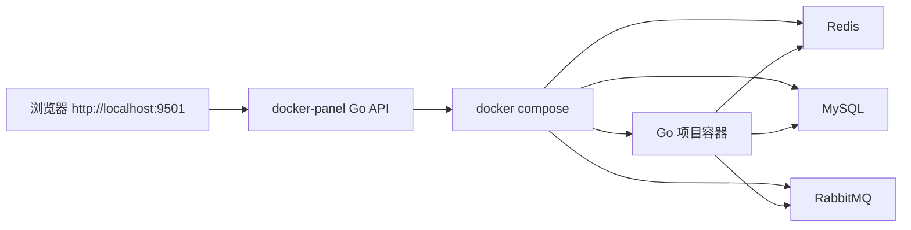

# Docker Panel Go-only 技术文档

## 目标

Docker Develop 统一切换到 Go-only 工作流：面板后端使用 Go，新建项目只生成 Go compose 服务。Go 服务通过自己的宿主机端口访问，基础依赖按项目勾选自动启动。

## 最终架构



## 模块边界

- `docker-panel/cmd/panel`：Go 入口，加载配置并启动 HTTP 服务。
- `docker-panel/internal/httpapi`：HTTP 路由、请求解析和响应封装。
- `docker-panel/internal/project`：Go 项目保存、启动任务、命令执行、compose block 生成和删除。
- `docker-panel/internal/compose`：本机 `docker-compose` / `docker compose` 调用封装。
- `docker-panel/internal/docker`：Docker API 访问，用于容器列表、日志和状态。
- `docker-panel/internal/storage`：`projects.json` 读写。
- `docker-panel/internal/task`：后台任务日志和状态轮询。
- `docker-panel/public/index.html`：单页面板前端。

## 项目创建流程

1. 前端提交 `POST /api/project-scaffold`。
2. 后端校验项目类型必须为 `go`。
3. 后端归一化项目标识、容器路径、端口、服务名和依赖列表。
4. 后端在 `docker-compose.yml` 中写入 `# BEGIN Go project` 管理块。
5. 后端保存 `projects.json`。
6. 用户点击启动时，后台任务依次执行直接启动、构建镜像、启动服务、检查容器状态、读取最近日志。

## Go 服务规范

生成的服务统一使用 `services/go/Dockerfile`，项目端口固定映射到容器 `8080`：

```yaml
ports:
  - "宿主机端口:8080"
```

默认命令会按顺序寻找入口：

```text
go run .
go run ./cmd/server
go run ./cmd/api
go run ./cmd/app
```

如果这些入口都不存在，会扫描第一个 `main` package 执行。

## 依赖服务

项目表单可选依赖：

- `redis`
- `mysql`
- `rabbitmq`

后端只会把被勾选的依赖写入 `depends_on` 和对应环境变量。Go 项目不需要 Nginx 代理，直接访问 `http://localhost:<port>`。

## 镜像源规则

`BASE_IMAGE_REGISTRY` 必须保持为空。镜像加速器应配置在 Docker Desktop 的 Docker Engine：

```json
{
  "registry-mirrors": [
    "https://mlvdenum.mirror.aliyuncs.com"
  ]
}
```

这样 Dockerfile 仍然使用官方镜像名，拉取动作由 Docker Engine 通过镜像加速器完成。

## 验证清单

```powershell
cd C:\Develop\Docker\docker-develop\docker-panel
$env:GOCACHE='C:\Develop\Docker\docker-develop\docker-panel\.gocache'
go test -mod=mod ./...
go vet -mod=mod ./...
```

```powershell
cd C:\Develop\Docker\docker-develop
$env:BASE_IMAGE_REGISTRY=''
docker-compose config --quiet
```

面板验证：

1. 启动 `docker-panel`。
2. 打开 `http://localhost:9501`。
3. 新建 Go 项目，勾选依赖并保存。
4. 点击启动，确认日志显示 compose 构建、启动和状态检查。
5. 打开项目 URL，确认服务可访问。

## 当前状态

- 面板后端已迁移为 Go。
- 项目管理入口只接受 Go 项目。
- 主 compose 不再声明旧项目运行时服务。
- Nginx 仅保留静态文件用途。
- 本机配置继续通过 `.env` 管理，示例见 `.env.example`。